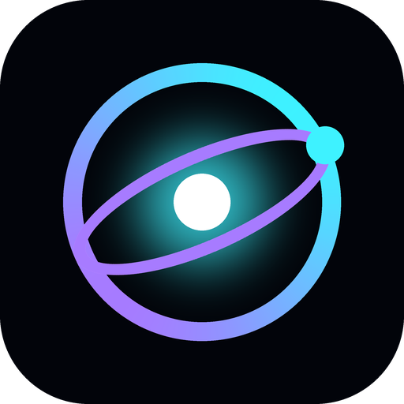
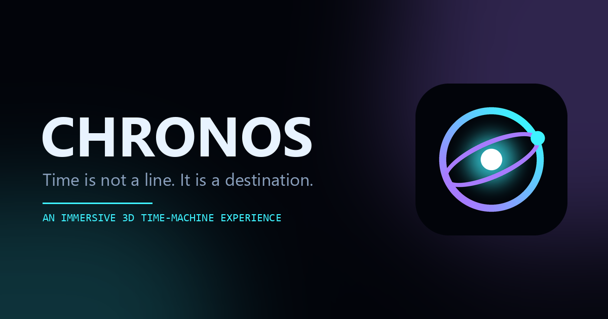

<p align="center">
  
</p>

<h1 align="center">CHRONOS</h1>

<p align="center">
  <b>An immersive, scroll-driven time-machine web experience.</b><br />
  <i>Time is not a line. It is a destination.</i>
</p>

<p align="center">
  <a href="https://harivansh-b.github.io/Chronos/"><b>▶ Live demo</b></a> ·
  <a href="#features">Features</a> ·
  <a href="#run-locally">Run locally</a> ·
  <a href="#deployment">Deployment</a>
</p>

<p align="center">
  
  
  
  
</p>

<p align="center">
  
</p>

A fictional science-fiction experience built with HTML, CSS, vanilla ES modules, Three.js,
GSAP + ScrollTrigger and Lenis. Scroll through a temporal portal into five explorable 3D eras, take
apart the time machine, and plot a jump from Mission Control. All readouts, specs and mission
entries are imaginary.

## Features

- **Cinematic journey:** a 700vh pinned sequence. The camera dives through the reactor portal
  and warps through five procedural eras: Prehistoric Earth, Ancient Civilization, the
  Industrial Age, the Present and the Distant Future.
- **Explorable 3D eras:** drag (or use ←/→) to look around each scene while scroll keeps driving
  the camera. Pulsing beacons mark landmarks (the sauropod, the Great Pyramid, the Great
  Escapement gear, Meridian Spire, the ringed planet…). Click one to turn toward it and open a
  scan card.
- **Inside the Machine:** an interactive reactor you can rotate. Pick any component to separate
  the housing and read its spec sheet.
- **Mission Control:** pick an era, set a target year and reactor power, then calculate and
  initiate a jump.
- **Soundtrack:** an audio toggle streams a CC0 ambient track, with a generative Web Audio drone
  as fallback.
- **Accessible and resilient:** keyboard-reachable controls, reduced-motion support, a
  no-WebGL fallback and lighter settings for mobile.

## Run locally

Libraries load as pinned ES modules from jsDelivr (`src/libs.js`), so there is no bundling step.

```bash
git clone https://github.com/harivansh-b/Chronos.git
cd Chronos
npm install      # installs Vite (dev server only)
npm run dev      # http://localhost:5173
```

No Node? Any static server works, e.g. `python -m http.server 5173` in the project folder.
(Opening `index.html` via `file://` will not work, because ES modules need http.)

## Deployment

The site is hosted on **GitHub Pages** at **https://harivansh-b.github.io/Chronos/**.

Every push to `main` runs [`.github/workflows/deploy-pages.yml`](.github/workflows/deploy-pages.yml),
which mirrors `main` to the `gh-pages` branch. GitHub Pages serves that branch as-is (`.nojekyll`
disables Jekyll processing). No build step is needed.

## Structure

```
index.html                     semantic markup for all sections, favicon + social meta
assets/                        logo (SVG + PNG), apple-touch icon, social preview image
src/main.js                    bootstraps everything, owns navigation-to-era logic
src/libs.js                    pinned CDN imports (three 0.160, gsap 3.12.5, lenis 1.1.13)
src/data.js                    eras, landmarks, machine components, mission log, soundtrack
src/style.css                  design system, layouts, responsive + reduced-motion rules
src/three/scene.js             renderer, camera director, single render loop, raycast + projection
src/three/timeMachine.js       procedural reactor (core, rings, stabilizer, nav core, anchor, portal shader)
src/three/eras.js              five procedural era environments (instanced trees/towers, gears, pyramids…)
src/three/particles.js         stars, dust, warp streaks, anomaly particle shader
src/three/interactions.js      machine hotspots, picking, drag-rotate, spec panel
src/three/eraInteractions.js   explorable eras: free-look, landmark beacons, scan card
src/animations/scroll.js       Lenis ⇄ ScrollTrigger sync, scrubbed scenes, reveals
src/animations/transitions.js  boot sequence, hero entrance, flash
src/ui/navigation.js           nav, mobile menu, progress, soundtrack toggle
src/ui/timeline.js             journey HUD + destination panels
src/ui/missionControl.js       console validation, diagnostics, jump
```

## How sync works

`#journey` is a 700vh section with a `position: sticky` stage. One scrubbed ScrollTrigger writes
`state.journey` (0–1). The render loop derives camera, ring speed, portal scale, warp intensity
and active era from that single value, and calls back to the UI only when the era changes.
Timeline, destination cards and Mission Control all convert an era index to a scroll position
(`eraProgress(i)`) and let Lenis scroll there, so the scene is always driven by real scroll.

Free-look in the eras adds a yaw/pitch offset (`state.lookYaw`, `state.lookPitch`) on top of the
scripted camera path, so dragging never fights the scroll position. Landmark copy lives in
`LANDMARKS` in `src/data.js`.

## Audio

The speaker button streams the soundtrack set in `SOUNDTRACK` (`src/data.js`). It loads only on
the first click. If the file can't play, the generative Web Audio drone is used instead. Swap the
`src` for your own track (e.g. `./audio/theme.mp3`) to change it.

## Fallbacks

- No WebGL → canvas removed, gradient background, components listed as buttons; all UI still works.
- `prefers-reduced-motion` → no boot, no warp streaks/shake, instant scroll jumps, no reveal motion.
- Mobile / ≤4 cores → fewer particles, lower pixel ratio, no MSAA, shorter pinned sections.

## Credits

- Soundtrack: [Outer Space Loop](https://opengameart.org/content/outer-space-loop) by wipics (CC0).
- Built with [three.js](https://threejs.org), [GSAP](https://gsap.com) and [Lenis](https://lenis.darkroom.engineering).

---

<p align="center"><sub>CHRONOS is a fictional concept experience, not a real time-travel service. © 2026 Harivansh B</sub></p>
