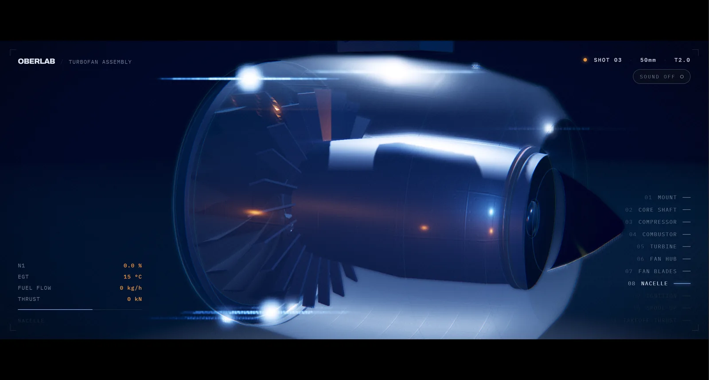

# Oberlab Turbofan Scroll

A cinematic, scroll-driven turbofan that assembles itself, lights off, and spools up to full thrust — all rendered live in the browser.

**[Launch the live demo →](https://lumsrouge.github.io/oberlab-turbofan-scroll/)**



## Why I built this

I wanted to see whether a website could make a product reveal feel more like a film sequence than a normal 3D viewer. That turned into a procedural jet engine, six camera setups, custom post-processing, synthesized sound, and a suspicious amount of attention paid to turbine glow.

I may have got slightly carried away. The good news is that the browser handles it surprisingly well.

This is also a portfolio piece for **Oberlab**, my AI and automation studio. It explores the kind of interactive work I enjoy building: technically ambitious, visually deliberate, and still useful as a real web experience.

## What it does

Scroll controls the entire sequence:

1. The core shaft, compressor, combustor, turbines, fan, and nacelle assemble in order.
2. Each part seats with a short mechanical impact, edge flash, and contact sparks.
3. The combustor lights while the camera pivots around the hot section.
4. The fan spools up, the intake vortex appears, and the engine reaches full thrust.
5. The final project notes sit over the live animation instead of replacing it.

Sound is optional and starts only after clicking **SOUND ON**. Browsers are sensible enough not to let a jet engine autoplay.

## Highlights

- Six cinematic camera framings from 28 mm to 85 mm
- Scroll-linked assembly with independent timing for 64 meshes
- Procedural geometry — no GLB or other 3D model files
- Hand-written GLSL for bloom, halation, depth of field, heat shimmer, radial fan blur, anamorphic flare, grain, vignette, and grading
- Canvas-generated metal, panel, heat, floor, and particle textures
- Procedural WebAudio for plate-lock impacts, ignition, hangar reverb, and low engine rumble
- Image-based lighting, a shadow-casting key, and a cool/warm night-hangar palette
- Responsive framing plus reduced-motion support

The whole engine is generated in code, so there are no model files hiding in the cargo hold.

## Built with

- [Three.js r160](https://threejs.org/)
- WebGL and GLSL
- Web Audio API
- Canvas 2D
- Plain HTML, CSS, and JavaScript

There is no framework, package installation, asset pipeline, analytics, form, cookie, or tracking script. At runtime the page loads Three.js from cdnjs and the Archivo / IBM Plex Mono fonts from Google Fonts.

## Run it locally

From this directory:

```bash
python -m http.server 8794
```

Then open [http://localhost:8794/](http://localhost:8794/).

## Editing and rebuilding

`turbofan.html` is the authoring source. `index.html` is generated and is the file served by GitHub Pages.

After editing the source:

```bash
python build.py
```

No build dependencies are required beyond Python.

## Project structure

```text
.
├── index.html       # Complete generated site / GitHub Pages entry
├── turbofan.html    # Authoring source
├── build.py         # Rebuilds index.html
├── favicon.svg      # Browser icon
└── preview.webp     # README preview
```

## About Oberlab

Oberlab is my AI and automation studio. I build practical automations and interactive digital experiences that combine solid engineering with a bit of visual personality.

## Usage and rights

This repository is public so the work can be viewed as part of my portfolio. It is **not** released under an open-source license, and no permission is granted to copy, redistribute, or create derivative works from the code or design.

If you would like to discuss using or adapting the experience, please contact me through GitHub.

© 2026 Oberlab. All rights reserved.
