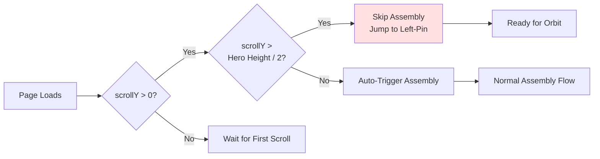
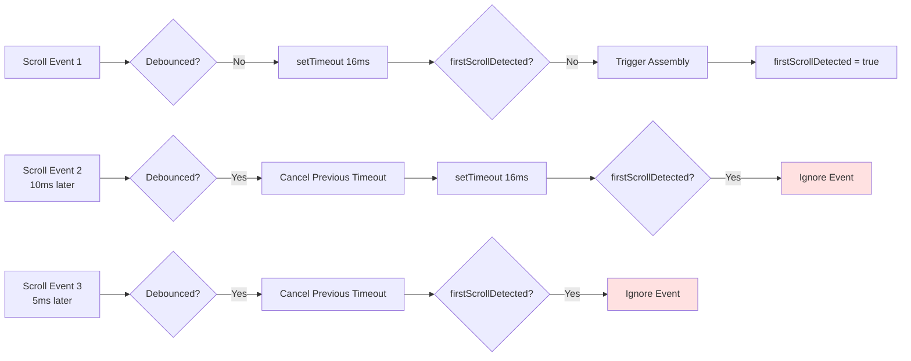
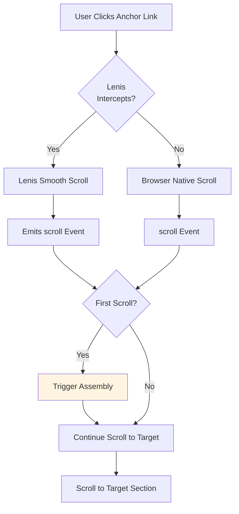
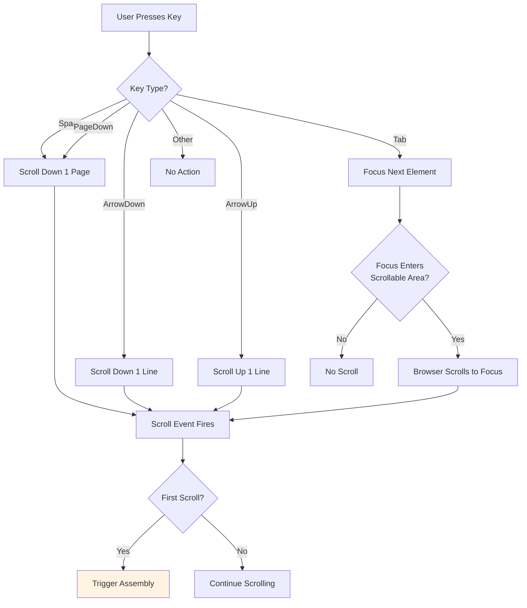
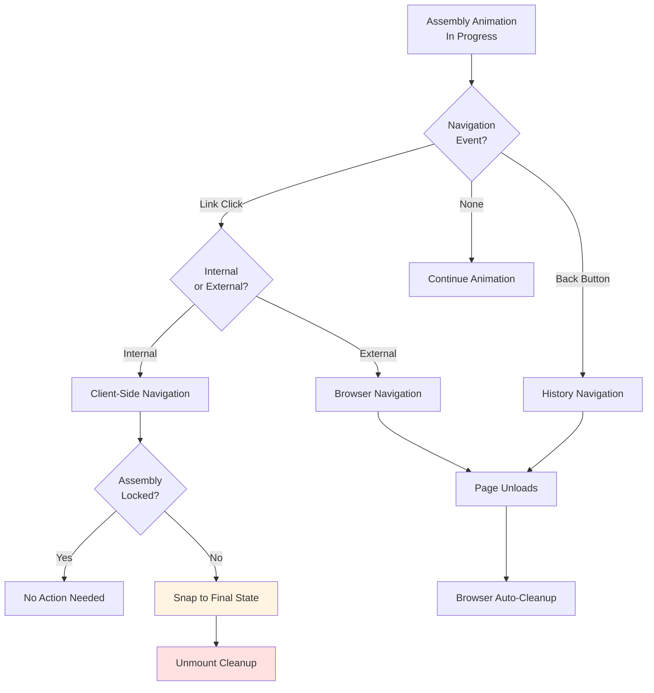
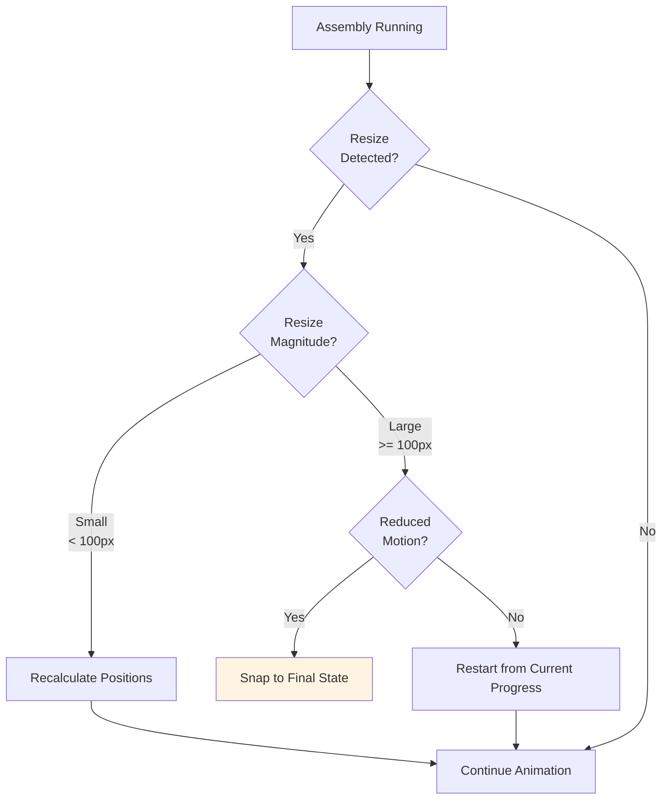
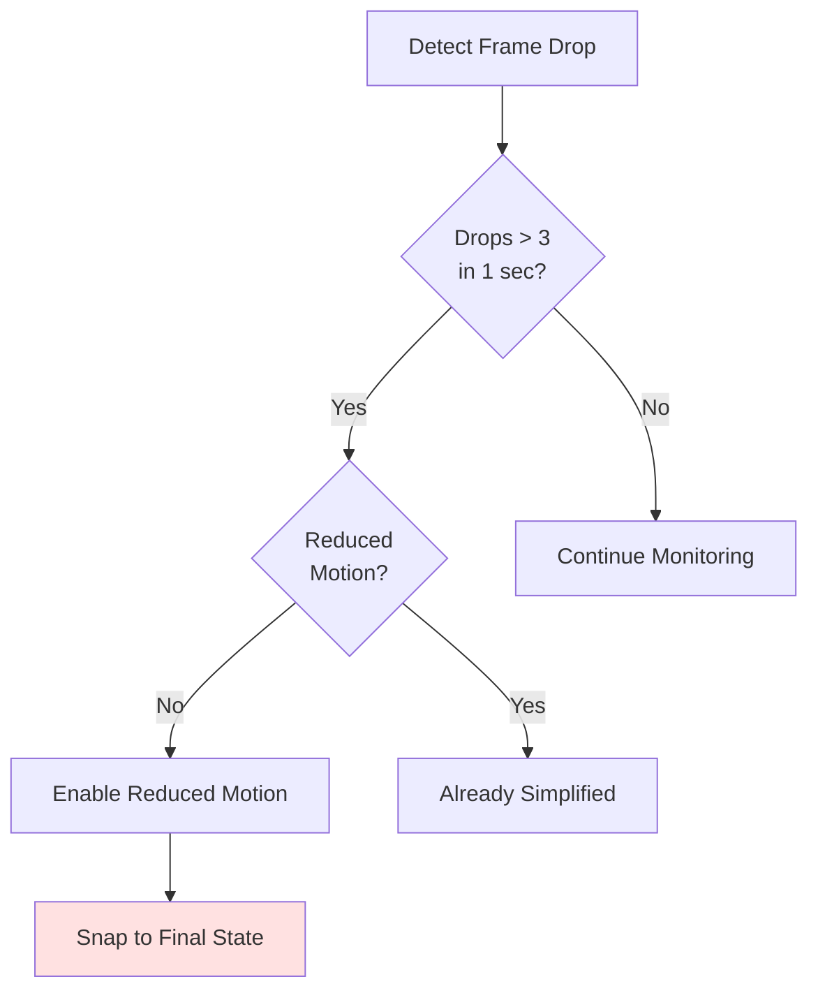
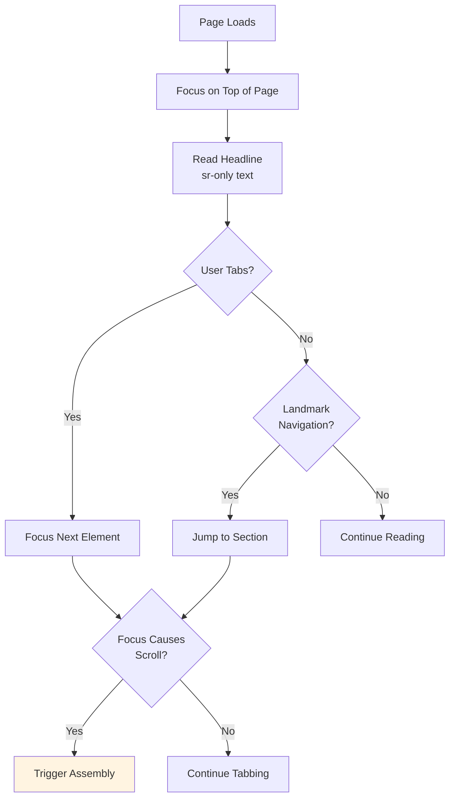

# Hero Assembly Interaction Flowchart

## Overview

This document maps the complete user interaction flow for the Hero Assembly feature, from initial page load through assembly completion and readiness for orbit. It includes all user input methods, edge cases, and error handling paths.

---

## Primary Interaction Flow

```mermaid
flowchart TD
    Start([User Lands on Page]) --> LoadCheck{Page Loaded?}

    LoadCheck -->|No| Loading[Show Loading State]
    Loading --> LoadCheck

    LoadCheck -->|Yes| InitCheck{OrbitSystem<br/>Initialized?}

    InitCheck -->|No| InitWait[Wait for Context]
    InitWait --> InitCheck

    InitCheck -->|Yes| LenisCheck{Lenis<br/>Ready?}

    LenisCheck -->|No| LenisWait[Initialize Lenis]
    LenisWait --> LenisCheck

    LenisCheck -->|Yes| LandingCheck{User Landed<br/>Mid-Page?}

    LandingCheck -->|Yes| AutoTrigger[Auto-Trigger Assembly]
    AutoTrigger --> StartAssembly

    LandingCheck -->|No| WaitingState[Waiting for First Scroll]

    WaitingState --> InputDetection{Input<br/>Detected?}

    InputDetection -->|Wheel Event| ScrollDeltaCheck{Delta > 0.1?}
    ScrollDeltaCheck -->|Yes| Debounce[Debounce 1 Frame]
    ScrollDeltaCheck -->|No| WaitingState

    InputDetection -->|Touch Event| TouchMoveCheck{Touchmove Delta?}
    TouchMoveCheck -->|Yes| Debounce
    TouchMoveCheck -->|No| WaitingState

    InputDetection -->|Keyboard| KeyCheck{Valid Key?}
    KeyCheck -->|Space/PageDown/<br/>Arrow| Debounce
    KeyCheck -->|Other Key| WaitingState

    InputDetection -->|Anchor Click| AnchorCheck{Lenis Scroll<br/>Triggered?}
    AnchorCheck -->|Yes| Debounce
    AnchorCheck -->|No| WaitingState

    Debounce --> FirstScrollCheck{First Scroll<br/>Already Triggered?}

    FirstScrollCheck -->|Yes| WaitingState
    FirstScrollCheck -->|No| MarkTriggered[Set firstScrollDetected = true]

    MarkTriggered --> StartAssembly[Emit 'hero_assembly_started']

    StartAssembly --> ReducedMotionCheck{Prefers<br/>Reduced Motion?}

    ReducedMotionCheck -->|Yes| SimpleAnimation[Simple Fade Animation]
    SimpleAnimation --> InstantAssembly[Instant Radial Snap]
    InstantAssembly --> HeadlineFade[Headline Fade 240ms]
    HeadlineFade --> InstantLeftPin[Instant Left-Pin]
    InstantLeftPin --> ReadyForOrbit

    ReducedMotionCheck -->|No| AnimateToAssembly[animateTo'assembly', 1.2s]

    AnimateToAssembly --> RadialIngress[32 Radials Arc Inward<br/>Stagger: 12ms × 32]

    RadialIngress --> AssemblyProgress{Assembly<br/>Progress}

    AssemblyProgress -->|0-50%| ContinueRadials[Continue Radial Animation]
    ContinueRadials --> AssemblyProgress

    AssemblyProgress -->|50%+| TriggerHeadline[Trigger Headline Reveal]

    TriggerHeadline --> PhaseCheck{Phase 1 or 2?}

    PhaseCheck -->|Phase 1| SimpleFade[Opacity/Scale/Y Animation]
    PhaseCheck -->|Phase 2| MaskReveal[SVG Mask pathLength Animation]

    SimpleFade --> HeadlineComplete
    MaskReveal --> HeadlineComplete[Headline Fully Visible]

    AssemblyProgress -->|100%| AssemblyLock[Assembly Lock]

    AssemblyLock --> SpringOvershoot[Spring Overshoot ~50ms]

    SpringOvershoot --> EmitLocked[Emit 'hero_assembly_locked']

    EmitLocked --> AudioCheck{Phase 3<br/>Audio Enabled?}

    AudioCheck -->|Yes| AudioPlay[Play Tone.js Lock Sound]
    AudioCheck -->|No| LeftPinStart

    AudioPlay --> LeftPinStart[Begin Left-Pin Transition]

    HeadlineComplete --> LeftPinStart

    LeftPinStart --> OriginShift[Origin: Center → Left<br/>Scale: 4 → 12<br/>Duration: 800ms]

    OriginShift --> LeftPinComplete[Left-Pin Complete]

    LeftPinComplete --> ReadyForOrbit[Ready for Orbit State]

    ReadyForOrbit --> MonitorScroll{User<br/>Scrolling?}

    MonitorScroll -->|Yes| CheckProgress{Scroll<br/>Progress > 20%?}
    CheckProgress -->|Yes| TransitionOrbit[Transition to Orbit Act 2]
    CheckProgress -->|No| MonitorScroll

    MonitorScroll -->|No| IdleState[Idle - Subtle Pulse]
    IdleState --> MonitorScroll

    TransitionOrbit --> End([Hero Assembly Complete])

    style Start fill:#e1f5ff
    style End fill:#e1f5ff
    style StartAssembly fill:#fff4e1
    style AssemblyLock fill:#fff4e1
    style ReadyForOrbit fill:#e1ffe1
    style ReducedMotionCheck fill:#ffe1e1
    style ErrorFallback fill:#ffcccc
```



---

## Edge Case Handling

### 1. Mid-Page Landing (History Navigation)

**Scenario**: User navigates back from another page, lands mid-way down Hero section



**Implementation**:
```typescript
useEffect(() => {
  if (window.scrollY > heroHeight / 2) {
    // User is past Hero, skip assembly
    setState('leftPinned');
    return;
  }

  if (window.scrollY > 0) {
    // User is partway through Hero, auto-trigger
    triggerAssembly();
  }
}, []);
```

---

### 2. Multiple Rapid Scroll Events

**Scenario**: User scrolls rapidly, multiple scroll events fire before debounce completes



**Implementation**:
```typescript
let debounceTimer: NodeJS.Timeout | null = null;
let firstScrollProcessed = false;

const onScroll = () => {
  if (firstScrollProcessed) return;

  if (debounceTimer) clearTimeout(debounceTimer);

  debounceTimer = setTimeout(() => {
    if (!firstScrollProcessed && Math.abs(scrollDelta) > 0.1) {
      firstScrollProcessed = true;
      triggerAssembly();
    }
  }, 16); // 1 frame at 60 FPS
};
```

---

### 3. Anchor Link Navigation

**Scenario**: User clicks anchor link (e.g., `<a href="#services">`) before first scroll



**Implementation**:
```typescript
// LenisProvider already handles anchor links
// No additional code needed, scroll events fire normally

// Ensure first-scroll detection catches Lenis programmatic scroll
lenis.on('scroll', (e) => {
  if (!firstScrollProcessed && Math.abs(e.velocity) > 0.1) {
    firstScrollProcessed = true;
    triggerAssembly();
  }
});
```

---

### 4. Keyboard Navigation (No Mouse/Touch)

**Scenario**: User navigates with keyboard only (accessibility)



**Implementation**:
```typescript
// Keyboard scroll events are automatically captured by scroll listener
// No special handling needed—scroll events fire regardless of input method

// Ensure focus-driven scroll also triggers assembly
document.addEventListener('focusin', (e) => {
  const target = e.target as HTMLElement;
  if (target.scrollIntoView) {
    // Browser will scroll, scroll event will fire
    // First-scroll detection will catch it
  }
});
```

---

### 5. Animation Interruption (User Navigates Away)

**Scenario**: User clicks link or goes back mid-assembly



**Implementation**:
```typescript
useEffect(() => {
  return () => {
    // Cleanup on unmount
    if (!assemblyLocked) {
      // Snap to final state instantly
      setState('leftPinned');
    }

    // Cancel any ongoing animations
    animationControls.stop();

    // Clear timers
    if (assemblyTimer) clearTimeout(assemblyTimer);

    // Remove event listeners
    window.removeEventListener('scroll', onScroll);
    document.removeEventListener('keydown', onKeyDown);
  };
}, [assemblyLocked]);
```

---

### 6. Browser Resize During Assembly

**Scenario**: User resizes browser window while assembly is animating



**Implementation**:
```typescript
const onResize = useCallback(() => {
  if (!assemblyLocked) {
    const resizeMagnitude = Math.abs(windowWidth - previousWidth);

    if (resizeMagnitude > 100) {
      // Large resize—restart or snap
      if (prefersReducedMotion) {
        setState('leftPinned');
      } else {
        // Recalculate radial positions and continue
        recalculateRadialPositions();
      }
    } else {
      // Small resize—just recalculate positions
      recalculateRadialPositions();
    }
  }
}, [assemblyLocked, prefersReducedMotion]);

useEffect(() => {
  window.addEventListener('resize', onResize);
  return () => window.removeEventListener('resize', onResize);
}, [onResize]);
```

---

## Input Method Specifications

### Mouse Wheel

**Detection**:
```typescript
window.addEventListener('wheel', (e) => {
  const delta = e.deltaY;
  if (Math.abs(delta) > 0.1 && !firstScrollProcessed) {
    triggerAssembly();
  }
}, { passive: true });
```

**Supported Devices**:
- Standard mouse wheel
- Trackpad two-finger scroll
- Magic Mouse swipe

---

### Touch

**Detection**:
```typescript
let touchStartY = 0;

window.addEventListener('touchstart', (e) => {
  touchStartY = e.touches[0].clientY;
}, { passive: true });

window.addEventListener('touchmove', (e) => {
  const touchDelta = e.touches[0].clientY - touchStartY;
  if (Math.abs(touchDelta) > 10 && !firstScrollProcessed) {
    triggerAssembly();
  }
}, { passive: true });
```

**Supported Devices**:
- Mobile touchscreens (iOS, Android)
- Tablet touchscreens
- Touchscreen laptops

---

### Keyboard

**Detected Keys**:
- **Space**: Scroll down ~1 viewport
- **PageDown**: Scroll down ~1 viewport
- **PageUp**: Scroll up ~1 viewport
- **ArrowDown**: Scroll down ~40px
- **ArrowUp**: Scroll up ~40px
- **Home**: Scroll to top (doesn't trigger if already at top)
- **End**: Scroll to bottom

**Detection**:
```typescript
document.addEventListener('keydown', (e) => {
  const scrollKeys = ['Space', 'PageDown', 'PageUp', 'ArrowDown', 'ArrowUp', 'Home', 'End'];

  if (scrollKeys.includes(e.code) && !firstScrollProcessed) {
    // Key will cause scroll, which will trigger scroll event
    // No need to trigger here—let scroll event handle it
  }
});
```

---

### Anchor Links

**Detection**: Handled automatically by Lenis

**Lenis Configuration**:
```typescript
const lenis = new Lenis({
  duration: 1.2,
  easing: (t) => Math.min(1, 1.001 - Math.pow(2, -10 * t)),
  // ... other options
});

// Anchor clicks emit scroll events
// First-scroll detection catches them naturally
```

---

## Error States & Fallbacks

### Failed Animation (GPU Overload)

**Symptoms**:
- Frame rate drops below 30 FPS
- Animation stutters or freezes

**Fallback**:


**Implementation**:
```typescript
let frameDropCount = 0;
let lastFrameTime = performance.now();

const checkPerformance = () => {
  const now = performance.now();
  const delta = now - lastFrameTime;

  if (delta > 33) { // > 2 frames dropped (33ms)
    frameDropCount++;
  }

  if (frameDropCount > 3) {
    // Performance degraded—enable fallback
    console.warn('Assembly performance degraded, enabling fallback');
    setState('leftPinned'); // Snap to final
  }

  lastFrameTime = now;
};

// Monitor during assembly
const raf = () => {
  if (!assemblyLocked) {
    checkPerformance();
    requestAnimationFrame(raf);
  }
};
requestAnimationFrame(raf);
```

---

### Lenis Not Initialized

**Symptoms**: Scroll events fire but Lenis velocity is unavailable

**Fallback**:
```typescript
const onScroll = () => {
  // Try to get Lenis velocity
  const lenisVelocity = lenis?.velocity ?? 0;

  // Fallback: calculate manual velocity
  const manualVelocity = (scrollY - previousScrollY) * 0.1;

  const velocity = lenisVelocity !== 0 ? lenisVelocity : manualVelocity;

  if (Math.abs(velocity) > 0.1 && !firstScrollProcessed) {
    triggerAssembly();
  }
};
```

---

### OrbitSystem Context Missing

**Symptoms**: `useOrbitSystem()` throws error

**Fallback**:
```typescript
try {
  const orbitSystem = useOrbitSystem();
  // Use orbitSystem...
} catch (error) {
  console.error('OrbitSystem not available:', error);
  // Render static emblem
  return <StaticEmblem />;
}
```

---

## Accessibility Interaction Paths

### Screen Reader Users



**Implementation Notes**:
- Headline uses `<h1>` with `sr-only` duplicate
- Assembly animation is purely visual (doesn't affect content)
- Screen readers access content immediately (no waiting)

---

### Keyboard-Only Users

**Tab Order**:
1. Skip to content link (optional)
2. Global navigation
3. Hero headline
4. CTA button (if present)
5. Next section

**Focus Indicators**: Maintain visibility during assembly animation

```typescript
// Ensure focus ring is visible
.focus-visible {
  outline: 2px solid var(--accent);
  outline-offset: 4px;
}
```

---

## References

- **Story File**: `docs/stories/1. STORY-hero-assembly.md` (First-Scroll Detection, Accessibility)
- **PRD**: `docs/PRD-ORBIT-SYSTEM.md` (Interaction Principles)
- **Implementation Plan**: `PRPs/hero-assembly.md` (Task breakdowns)
- **State Machine**: `docs/architecture/hero-assembly-state-machine.md`
- **Motion Timeline**: `docs/architecture/hero-assembly-motion-timeline.md`