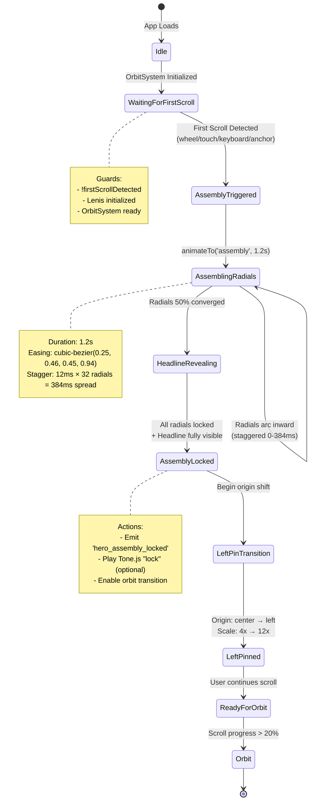
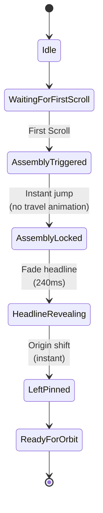

# Hero Assembly State Machine

## Overview

The Hero Assembly feature uses OrbitSystem's state machine to orchestrate the emblem's transformation from a latent, dispersed state into a fully assembled, left-pinned pose. This document visualizes the state transitions, guards, and actions involved in the assembly sequence.

## State Machine Diagram



## State Definitions

### 1. **Idle**
**Initial State**: App has loaded, OrbitSystem is initializing

**Emblem Configuration**:
```typescript
{
  x: 50, y: 50, z: 0,
  scale: 1,
  rotateX: 0, rotateY: 0, rotateZ: 0,
  opacity: 1,
  originX: 50, originY: 50
}
```

**Radials**: Subtle breathing animation (scale 1.0 → 1.02 → 1.0 over 4s)

**Headline**: Hidden or in initial "flipped" state

---

### 2. **WaitingForFirstScroll**
**Purpose**: Detect the first meaningful user interaction

**Guards**:
- `firstScrollDetected === false`
- Lenis smooth scrolling initialized
- OrbitSystem context ready

**Listening For**:
- `wheel` events (mouse scroll)
- `touchmove` events (touch scroll)
- `keydown` events (Space, PageDown, ArrowDown, ArrowUp)
- Anchor link navigation (via Lenis)

**Edge Cases**:
- User lands mid-page (history back): Auto-trigger assembly
- Browser auto-scroll on load: Debounce by 1 frame

---

### 3. **AssemblyTriggered**
**Purpose**: Begin emblem assembly animation

**Entry Action**:
```typescript
animateTo('assembly', 1.2); // Duration in seconds
```

**State Configuration** (target):
```typescript
{
  x: 50, y: 50, z: 0,
  scale: 1,           // Starts at current, ends at 1
  rotateX: 0, rotateY: 0, rotateZ: 0, // Unrotate to neutral
  opacity: 1,
  originX: 50, originY: 50
}
```

**Events Emitted**:
- `hero_assembly_started` (instrumentation)

**Transition**: Automatic to `AssemblingRadials`

---

### 4. **AssemblingRadials**
**Purpose**: Animate 32 radials from dispersed positions to emblem center

**Duration**: 1.2s total (with 384ms stagger spread)

**Per-Radial Animation**:
```typescript
{
  from: {
    x: cos(angle) * 800,  // Dispersed in circle
    y: sin(angle) * 800,
    scale: 0.5,
    opacity: 0,
    rotate: 45
  },
  to: {
    x: 0, y: 0,           // Center position
    scale: 1,
    opacity: 1,
    rotate: 0
  },
  delay: index * 0.012,   // 12ms stagger
  easing: [0.25, 0.46, 0.45, 0.94]
}
```

**Quadrant Grouping**: Radials grouped by quadrant (0-7, 8-15, 16-23, 24-31) to prevent linear wipe

**Progress Tracking**: `assemblyProgress` = 0.0 → 1.0 over 1.2s

---

### 5. **HeadlineRevealing**
**Purpose**: Reveal headline through SVG mask synchronized with radial assembly

**Trigger**: `assemblyProgress >= 0.5` (radials 50% converged)

**Animation** (Phase 1 - No Mask):
```typescript
{
  opacity: 0 → 1,
  scale: 0.98 → 1.0,
  y: 10 → 0,
  duration: 0.6s,
  easing: 'easeOut'
}
```

**Animation** (Phase 2 - With Mask):
```typescript
// SVG mask pathLength animates per radial
{
  pathLength: 0 → 1,
  delay: index * 0.012,  // Match radial stagger
  duration: 0.7s
}
```

**Accessibility**: Headline text present from T0 (sr-only duplicate)

---

### 6. **AssemblyLocked**
**Purpose**: Radials snap to final position, emblem stabilized

**Trigger**: All radial animations complete (`assemblyProgress === 1.0`)

**Entry Actions**:
1. Emit `hero_assembly_locked` event
2. Play Tone.js "lock" sound (Phase 3, optional)
   - Frequency: 80-120 Hz (sub bass)
   - Duration: ~150ms
   - Amplitude: Subtle (0.3)
3. Set `firstScrollDetected = true` (prevent re-trigger)

**Exit Condition**: User continues scrolling OR auto-advance after 500ms

---

### 7. **LeftPinTransition**
**Purpose**: Transform emblem from center-origin to left-pinned hero pose

**Duration**: 0.8s

**Transform Sequence** (from PRD V1 pattern):
```typescript
const progress = 0 → 1; // Over 0.8s
const eased = easeInOut(progress);

originX.set(lerp(50, 0, eased));    // Center → Left edge
originY.set(50);                    // Maintain vertical center
x.set(lerp(startX, endX, eased));   // Compensate for origin shift
scale.set(lerp(4, 12, eased));      // Dramatic scale increase
```

**Visual Effect**: Emblem appears to expand leftward, maintaining position despite origin change

**Easing**: `cubic-bezier(0.33, 1, 0.68, 1)` (perpetual motion)

---

### 8. **LeftPinned**
**Purpose**: Emblem rests in left-pinned hero pose, ready for scroll-driven orbit

**Final Configuration**:
```typescript
{
  x: compensatedX,    // Adjusted for left origin
  y: 50,
  z: 0,
  scale: 12,          // Large hero scale
  rotateX: 0, rotateY: 0, rotateZ: 0,
  opacity: 1,
  originX: 0,         // Left edge
  originY: 50         // Vertical center
}
```

**User Affordance**: Subtle pulse or micro-motion hints at scroll interaction

---

### 9. **ReadyForOrbit**
**Purpose**: Monitor scroll progress, prepare for orbit transition

**Guards**:
- `scrollProgress > 0.2` (20% down the page)
- Assembly fully locked

**Transition**: Automatic to `Orbit` state (Act 2)

---

### 10. **Orbit**
**Purpose**: Emblem enters orbital motion (Act 2: Exploration)

**Note**: This state is beyond Hero Assembly scope but included for completeness

---

## State Transition Guards

### First Scroll Detection Guards

```typescript
function canTriggerAssembly(): boolean {
  return (
    !firstScrollDetected &&           // Haven't triggered yet
    lenisInitialized &&                // Smooth scroll ready
    orbitSystemReady &&                // Context mounted
    Math.abs(scrollDelta) > 0.1       // Meaningful scroll delta
  );
}
```

### Assembly Lock Guards

```typescript
function isAssemblyComplete(): boolean {
  return (
    assemblyProgress >= 1.0 &&        // All radials animated
    allRadialsStable &&               // No ongoing animations
    headlineFullyVisible              // Opacity === 1
  );
}
```

### Orbit Readiness Guards

```typescript
function isReadyForOrbit(): boolean {
  return (
    assemblyLocked &&                 // Assembly complete
    leftPinComplete &&                // Origin shift done
    scrollProgress > 0.2              // User scrolling
  );
}
```

---

## Reduced Motion State Machine

When `prefers-reduced-motion` is detected, the state machine simplifies:



**Simplifications**:
- No radial travel (instant snap to position)
- No stagger delays
- Simple fade for headline (240ms)
- No audio feedback
- Origin shift is instant (no interpolation)

---

## State Persistence & Cleanup

### Session Storage
Assembly state is NOT persisted across page reloads. Each visit experiences the assembly.

### Cleanup on Unmount
```typescript
useEffect(() => {
  // Setup listeners...

  return () => {
    // Cancel ongoing animations
    animationRef.current?.cancel();

    // Remove event listeners
    window.removeEventListener('scroll', onScroll);
    document.removeEventListener('keydown', onKeyDown);

    // Clear timers
    clearTimeout(assemblyTimer);
  };
}, []);
```

---

## Performance Considerations

### State Transition Timing Budget

| Transition | Duration | Frame Budget (60 FPS) |
|-----------|----------|----------------------|
| Idle → WaitingForFirstScroll | Instant | N/A |
| WaitingForFirstScroll → AssemblyTriggered | < 100ms | 6 frames |
| AssemblyTriggered → AssemblingRadials | Instant | N/A |
| AssemblingRadials | 1.2s | 72 frames |
| HeadlineRevealing | 0.6s (overlap) | 36 frames |
| AssemblyLocked | Instant | N/A |
| LeftPinTransition | 0.8s | 48 frames |
| LeftPinned → ReadyForOrbit | Instant | N/A |

**Total Assembly Time**: ~2.0s (from first scroll to ready for orbit)

### GPU Acceleration
All state transitions use GPU-accelerated properties only:
- `transform` (translate, scale, rotate)
- `opacity`

No layout-thrashing properties (width, height, top, left, etc.)

---

## Error Handling & Edge Cases

### Failed First Scroll Detection
**Scenario**: Lenis not initialized, or scroll events blocked

**Fallback**: Manual trigger via keyboard (Tab + Enter on emblem)

### Animation Interruption
**Scenario**: User navigates away mid-assembly

**Handling**:
```typescript
useEffect(() => {
  return () => {
    // Cleanup: snap to final state instantly
    if (!assemblyLocked) {
      setState('leftPinned');
    }
  };
}, [assemblyLocked]);
```

### Multiple First Scrolls
**Scenario**: Debounce failure, multiple scroll events fire rapidly

**Prevention**:
```typescript
let firstScrollProcessed = false;

const onFirstScroll = () => {
  if (firstScrollProcessed) return;
  firstScrollProcessed = true;
  // Trigger assembly...
};
```

---

## Testing State Machine

### Unit Tests (Future)
```typescript
describe('Hero Assembly State Machine', () => {
  it('should transition idle → assembly on first scroll', () => {
    const { result } = renderHook(() => useOrbitSystem());
    act(() => result.current.onFirstScroll());
    expect(result.current.currentState).toBe('assembly');
  });

  it('should not re-trigger assembly on subsequent scrolls', () => {
    // Test firstScrollDetected guard...
  });

  it('should respect prefers-reduced-motion', () => {
    // Test simplified state flow...
  });
});
```

### Manual QA Checklist
- [ ] First scroll (wheel) triggers assembly
- [ ] First touch scroll triggers assembly
- [ ] Keyboard (Space, PageDown, Arrow) triggers assembly
- [ ] Anchor link navigation triggers assembly
- [ ] Mid-page refresh auto-triggers assembly
- [ ] Subsequent scrolls don't re-trigger
- [ ] Reduced motion skips animation
- [ ] Fast navigation doesn't break state
- [ ] All transitions respect 60 FPS

---

## References

- **Story File**: `docs/stories/1. STORY-hero-assembly.md`
- **PRD**: `docs/PRD-ORBIT-SYSTEM.md` (Act 1: Assembly)
- **Implementation Plan**: `PRPs/hero-assembly.md`
- **OrbitSystem**: `src/context/OrbitSystem.tsx`
- **Emblem Component**: `src/components/emblem/Emblem.tsx`