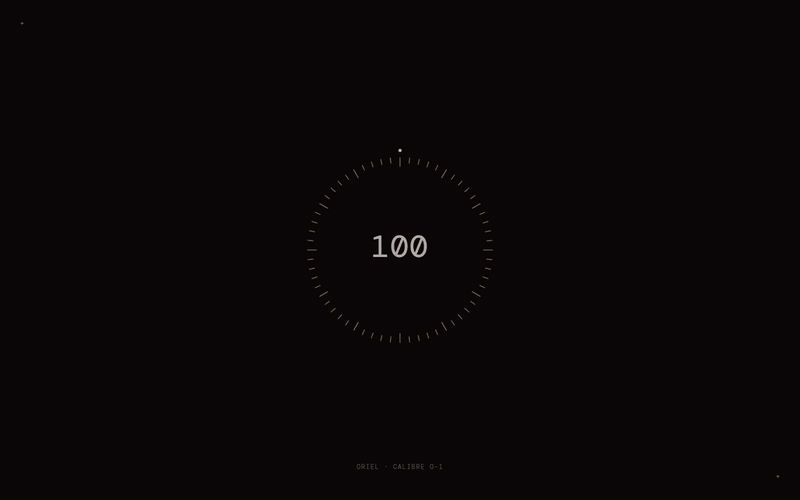
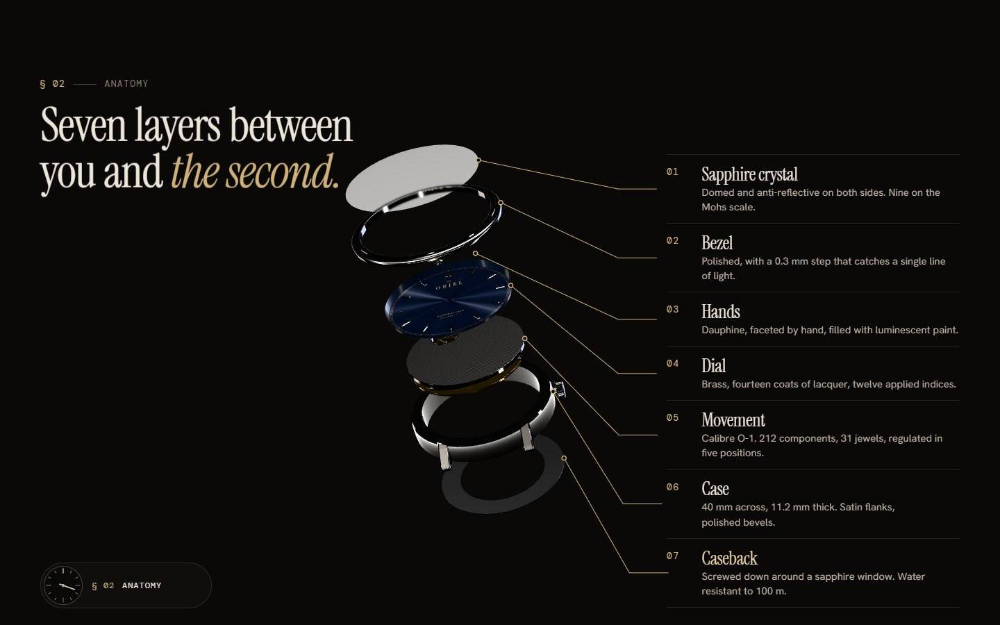
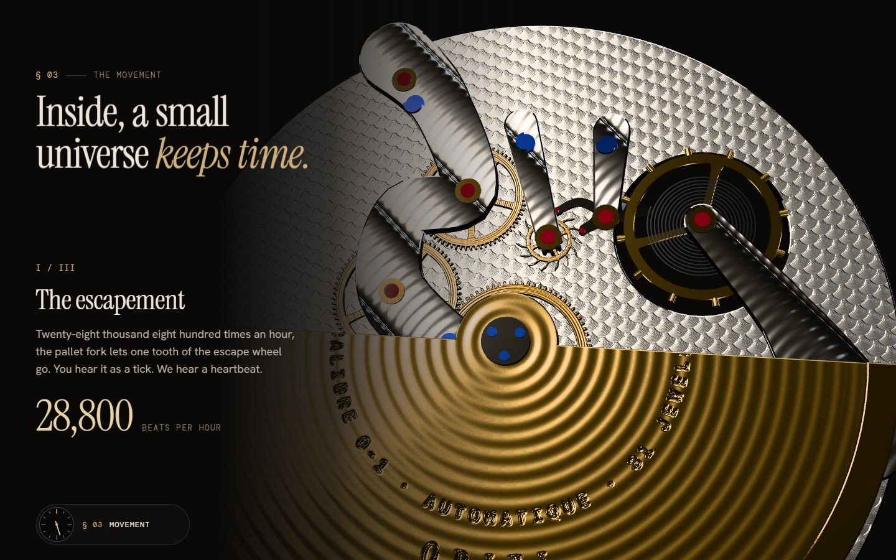
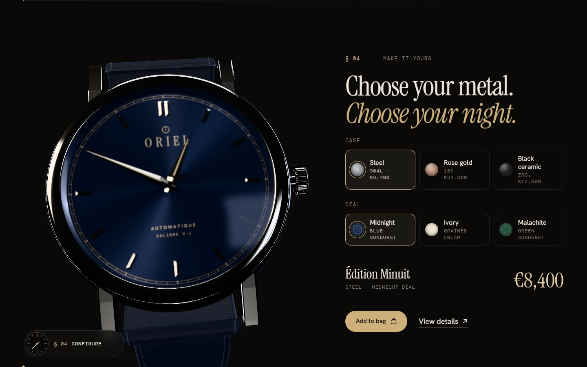
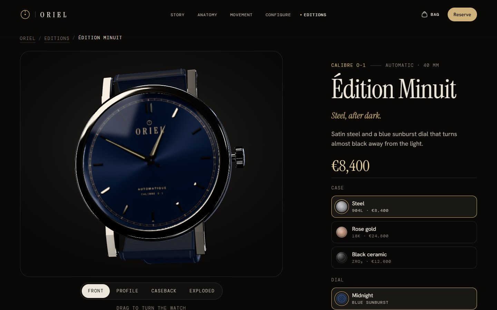

# ORIEL — Time, taken apart

A scroll-driven story for a fictional independent watchmaker, built as a portfolio piece by **Ayoub Benkreira**.
The Calibre O-1 is modelled entirely in code with Three.js. Scroll to take it apart layer by layer, travel
into the movement, then rebuild it in your own metal and reserve one.

> ORIEL is a concept. It is not a real brand, nothing is for sale, and checkout is switched off.

[](docs/oriel-scroll-tour.mp4)

**[▶ Watch the scroll tour](docs/oriel-scroll-tour.mp4)** · **[Live site](https://oriel-watch.vercel.app)**

## Highlights

- **Procedural 3D watch**: case, dial, hands, a moving gear train, jewels, rotor and strap, all generated in
  Three.js with no downloaded models or HDRIs. The hands show the visitor's real local time, and the
  seconds hand steps 8 times a second (28,800 vph).
- **Scroll storytelling**: GSAP ScrollTrigger and Lenis drive a single pose track for the watch across the
  page (hero → manifesto → exploded anatomy → movement dive → configurator → reserve).
- **Signature interactions**: magnetic buttons with a directional fill and rolling labels, an iris
  preloader and page transition, hold-to-reserve, odometer prices, a working bag drawer, and a
  drag-to-turn product viewer.
- **Accessible by default**: semantic markup, keyboard support, visible focus, accessible split text,
  and a complete static experience under `prefers-reduced-motion`, without WebGL, or without JavaScript
  (every still is rendered from the same 3D model).

## Screenshots

| | |
| --- | --- |
|  |  |
| **Anatomy.** The watch separates into seven layers as you scroll. | **Movement.** The camera dives into the escapement, barrel and rotor. |
|  |  |
| **Configure.** Pick a metal and a dial, and the 3D watch re-finishes live. | **Product page.** A drag-to-turn viewer with front, profile, caseback and exploded views. |

Captured from the running site with `npm run screenshots`.

## Stack

Vite · vanilla JavaScript (ES modules) · GSAP 3 (ScrollTrigger, CustomEase) · Lenis · Three.js ·
Fontsource (Instrument Serif, Hanken Grotesk, DM Mono) · Solar icons via Iconify.

## Scripts

```bash
npm install
npm run dev        # local dev server
npm run build      # production build into dist/
npm run preview    # serve the production build
npm run posters    # re-render public/media/* from the 3D model (needs Edge or Chrome installed)
npm run screenshots # re-capture docs/screenshots/* for this README (needs Edge or Chrome installed)
```

Dev-only query flags: `?reduced` (force reduced motion), `?nowebgl` (force the poster fallback),
`?tier=low` (low-end 3D settings).

## Structure

```
docs/DIRECTION.md   art direction, motion rules and the module contract
src/core/           environment, motion (GSAP + Lenis), accessible text splitting, boot
src/three/          procedural watch, materials, studio lighting, stage and poses
src/ui/             buttons, cursor, nav, preloader, page transitions, bag, hold, odometer, configurator
src/sections/       index-page chapters and the director that drives the watch from scroll
src/pages/          product page
scripts/            poster renderer, README screenshots
```

## Credits

- Concept, design and development: Ayoub Benkreira.
- Icons: [Solar](https://www.figma.com/community/file/1166831539721848736) by 480 Design, CC BY 4.0, via Iconify.
- Fonts: Instrument Serif, Hanken Grotesk and DM Mono (SIL Open Font License), self-hosted via Fontsource.
- Every image of the watch is rendered from the site's own Three.js model (`npm run posters`).
