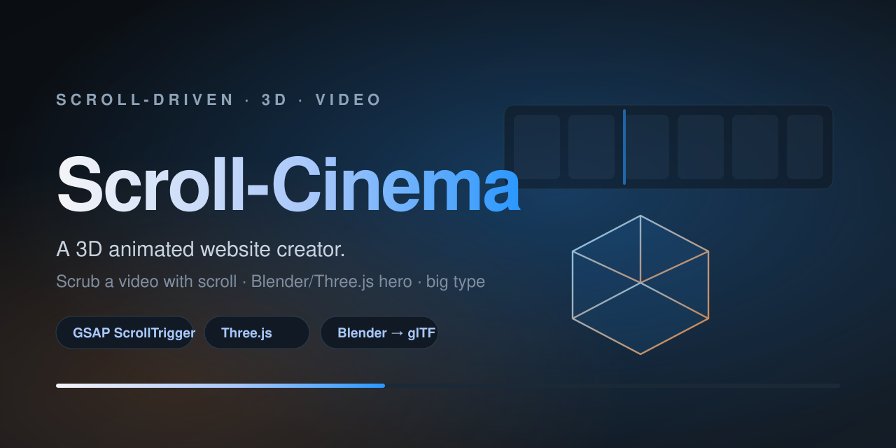
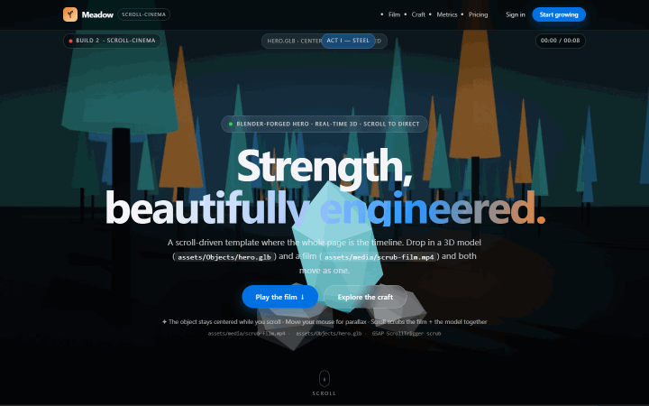

<p align="center">
  
</p>

<h1 align="center">Scroll-Cinema</h1>
<p align="center"><strong>The 3D animated website creator.</strong><br>
Turn a video and a 3D model into a scroll-driven cinematic landing page — the whole page is the timeline.</p>

<p align="center">
  <a href="LICENSE"></a>
  
  
  
  
</p>

<p align="center">
  <a href="#live-demo"><b>Live demo</b></a> ·
  <a href="#quick-start">Quick start</a> ·
  <a href="#what-you-need-to-supply">Requirements</a> ·
  <a href="#how-it-works-the-engineering">How it works</a> ·
  <a href="#the-ai-agent-skill">AI-agent skill</a>
</p>

---

**Scroll down → the film plays forward. Scroll up → it reverses, frame-perfect.** A 3D object stays centered and choreographed to the same clock. Big typography carries the story. Apple/Stripe-grade motion, in plain HTML/CSS/JS.

This repo is two things:

1. **A template** — drop in your own video + 3D model and you have a cinematic scroll site.
2. **An AI-agent skill** (`skill/`) — the complete, model-agnostic playbook that builds one of these from scratch: discovery interview, asset pipeline, implementation, and browser verification.

> 🎁 **The demo ships with original, project-owned assets** — a procedurally-generated "neon forest" film (`assets/media/scrub-film.mp4`) and a faceted crystal (`assets/Objects/hero.glb`), both built by [`scripts/demo-clip.py`](scripts/demo-clip.py) and [`scripts/demo-model.py`](scripts/demo-model.py) and safe to redistribute (MIT / CC0). Swap them for your own to make it yours.

---

## Live demo

**https://indranilnnd-creator.github.io/amazing-3d-animated-website-creator/**

<p align="center"></p>

> Scrolling scrubs the film forward; scrolling back reverses it, frame-perfect. The 3D crystal stays centered and rotates on the same scroll clock.

## Features

- 🎬 **Scroll-scrubbed video background** — `currentTime = pageProgress × duration`; forward on scroll-down, cleanly reversible on scroll-up. No `play()`, no loop, no stutter.
- 🧊 **Real 3D hero** — any Blender object exported to glTF, lit with image-based lighting and PBR, kept centered in a fixed layer while the page scrolls beneath it.
- 🖤 **Black-proof film rendering** — the video is only a decoder; a canvas draws each frame and **holds the last good frame**, so the background can never flash black (a failure mode of bare `<video>` scrubbing).
- ✍️ **Large typography overlays** — full-screen "beats" with per-word reveals, over the film.
- 🧭 **One shared scroll clock** — film, 3D object, camera and HUD all read the same GSAP ScrollTrigger progress, so everything stays in sync both directions.
- 🧩 **Optional spatial content anchoring** — pin product cards / details / prices to coordinates *in the video frame* (see [`skill/references/anchoring.md`](skill/references/anchoring.md)).
- 📦 **Vendored, offline-proof** — GSAP, ScrollTrigger, Lenis and Three.js ship in `assets/vendor/`. No runtime CDN.
- ♿ **Respects `prefers-reduced-motion`** — static frame, readable copy, no scrub.
- 🚫 **No build step** — plain HTML/CSS/JS. Open `index.html` and go.

---

## Quick start

```bash
git clone https://github.com/indranilnnd-creator/amazing-3d-animated-website-creator.git
cd amazing-3d-animated-website-creator

# serve it (any static server works)
python -m http.server 8080
# open http://localhost:8080
```

You'll see the demo running with its original film + crystal. **Replace them with your own** at the same paths:

| Path | To change |
|---|---|
| `assets/media/scrub-film.mp4` | your scroll-scrubbed film (all-intra 720p — see below) |
| `assets/media/scrub-poster.jpg` | your first-paint still |
| `assets/Objects/hero.glb` | your 3D hero object |

Paths are **probed** with a `HEAD` request: delete an asset and its graceful fallback (gradient film / procedural cube) takes over automatically.

---

## What you need to supply

To make the site **yours**, you'll want two assets of your own. The demo ships original CC0 stand-ins (a forest film + a crystal), so this section is about replacing them — the requirements below apply to whatever you bring.

### 1. A video — encoded **all-intra 720p** (this matters)

> **The #1 reason scroll-video fails is the encode.** A normal 4K H.264 file has sparse keyframes; every scroll seek must decode from the last keyframe — up to ~1.3 s, during which the element has **no frame to draw** and renders **black**. You get "plays, then black, then repeats."
>
> The fix is **all-intra** — a keyframe on *every* frame — so any seek decodes one frame instantly.

Convert with Blender (no ffmpeg needed). Full script in
[`skill/references/asset-pipeline.md`](skill/references/asset-pipeline.md); the essential part:

```python
import bpy, os
src = os.path.abspath("your-video.mp4")
sc = bpy.context.scene
sed = sc.sequence_editor_create()
clip = bpy.data.movieclips.load(src)                 # MovieClip, not a path string
strip = sed.strips.new_clip("film", clip, 1, 1)
r = sc.render
r.resolution_x, r.resolution_y = 1280, 720           # 720p under a scrim is plenty
r.image_settings.media_type = "VIDEO"                # REQUIRED before "FFMPEG" (Blender 4.5+/5.x)
r.image_settings.file_format = "FFMPEG"
r.ffmpeg.format = "MPEG4"; r.ffmpeg.codec = "H264"
r.ffmpeg.gopsize = 1                                 # <-- keyframe EVERY frame = instant seeks
r.ffmpeg.constant_rate_factor = "MEDIUM"; r.ffmpeg.audio_codec = "NONE"
r.filepath = os.path.abspath("assets/media/scrub-film")
bpy.ops.render.render(animation=True)
```

Run it headless:
```bash
blender --background --python encode.py
# rename scrub-film0001-NNNN.mp4 -> assets/media/scrub-film.mp4
```

Requirements checklist:
- ✅ H.264 MP4, ~1280×720, keyframe on every frame (`gopsize = 1`)
- ✅ Muted / no audio track
- ✅ A poster frame exported as `assets/media/scrub-poster.jpg`

### 2. A 3D model — glTF/GLB

Export any Blender object to GLB, **selection only**:

```python
import bpy
obj = bpy.data.objects["YourObjectName"]        # discover names first: [o.name for o in bpy.data.objects]
bpy.ops.object.select_all(action='DESELECT')
obj.select_set(True); bpy.context.view_layer.objects.active = obj
bpy.ops.export_scene.gltf(filepath="assets/Objects/hero.glb", export_format='GLB',
                          use_selection=True, export_apply=True, export_yup=True, export_materials='EXPORT')
```

The template auto-centers and auto-scales whatever you give it (`fitObject`), so no hand-tuning.

### 3. (Optional) Node.js — only to re-vendor the libraries

The libraries are already committed under `assets/vendor/`. To upgrade them:

```bash
npm install gsap@3 three@0.160.0 lenis@1.1.14
node scripts/vendor-libs.mjs
```

---

## How it works (the engineering)

Everything hangs off **one number**: page scroll progress `0…1`.

```js
ScrollTrigger.create({
  trigger: document.body, start: "top top", end: "bottom bottom", scrub: 1,
  onUpdate: function (self) {
    video.currentTime = self.progress * video.duration; // film = scroll
    scrollState.progress = self.progress;                // shared with the 3D stage
  }
});
```

Four details make it actually work — these are the hard-won bits:

1. **All-intra footage.** Otherwise every seek blanks to black (see above).
2. **Scroll owns `currentTime`; never `play()`.** Native playback is what makes a background film "loop by itself."
3. **A canvas draws the film and holds the last frame.** The `<video>` is a decoder only. If a seek has no data yet, the canvas keeps the previous frame — the background is black-proof across browsers/GPUs.
4. **The 3D object lives in a fixed layer** (`pointer-events: none`) so it never scrolls away; orbit is mouse-parallax + a scroll-linked rotation from the shared clock.

### Why a canvas, not just `<video>`?

A bare `<video>` paints a blank frame whenever it has no decoded frame — which happens mid-seek. On some GPUs that's a visible black flash. Drawing to a canvas and *not drawing* when there's nothing new means the last frame simply stays put. Zero black.

### Architecture

```
.film-bg        fixed, z0   →  video (decoder) + canvas (renderer) + scrim + grain
.stage3d        fixed, z1   →  Three.js hero (pointer-events:none)
main            relative,z2 →  scrolling content: hero, film beats, sections
```

---

## The AI-agent skill

The repo ships the complete playbook in [`skill/`](skill/) — written to be executed by **any** model, small or large:

| File | What it covers |
|---|---|
| [`SKILL.md`](skill/SKILL.md) | the workflow: discovery interview → spec → build → verify |
| [`references/asset-pipeline.md`](skill/references/asset-pipeline.md) | Blender GLB export + all-intra transcode + poster |
| [`references/code-templates.md`](skill/references/code-templates.md) | full copy-paste HTML/CSS/JS skeleton |
| [`references/anchoring.md`](skill/references/anchoring.md) | content pinned to objects in the video (3 fidelity levels) |
| [`references/vendoring.md`](skill/references/vendoring.md) | vendoring GSAP/Three/Lenis locally |
| [`references/verification.md`](skill/references/verification.md) | headless-browser proof harness |
| [`references/build-spec.md`](skill/references/build-spec.md) | the interview → spec template |

Install it as a personal skill by copying `skill/` into your agent's skills folder. It asks **you** what objects, background, transitions, colours, fonts and content to use — then builds and verifies.

---

## Customization

| Want to change | Edit |
|---|---|
| Colours, type, spacing | `assets/css/styles.css` (`:root` tokens) |
| Scroll behaviour, 3D choreography | `assets/js/main.js` |
| Copy, sections, beats | `index.html` |
| Product name / branding | `index.html` (title, brand) + `assets/favicon.svg` |

Bump the `?v=N` query on the CSS/JS links (and the HUD build badge) on every change so browsers don't serve a stale copy.

---

## Project structure

```
index.html                     markup
assets/css/styles.css          all styling (film, hero, beats, sections)
assets/js/main.js              scroll engine, canvas film, 3D hero, choreography
assets/vendor/…                GSAP, ScrollTrigger, Lenis, Three.js (committed, no CDN)
assets/media/scrub-film.mp4    original CC0 demo film (all-intra)
assets/media/scrub-poster.jpg  first-paint still
assets/Objects/hero.glb        original CC0 demo model (faceted crystal)
scripts/vendor-libs.mjs        re-copy libraries into assets/vendor/
scripts/demo-clip.py           Blender generator for the demo film
scripts/demo-model.py          Blender generator for the demo model
scripts/make-demo-gif.mjs      regenerates docs/demo.gif
skill/                         the AI-agent playbook
docs/banner.svg                README hero
docs/demo.gif                  README demo
```

---

## Contributing

PRs and issues welcome — new choreography presets, anchoring examples, better fallbacks. See [CONTRIBUTING.md](CONTRIBUTING.md). If this saves you time, a ⭐ helps a lot.

## Credits

Built with [GSAP](https://gsap.com) + ScrollTrigger, [Lenis](https://github.com/darkroomengineering/lenis), and [Three.js](https://threejs.org). 3D pipeline uses [Blender](https://www.blender.org).

## License

Code is [MIT](LICENSE). The included demo film and model are original — generated by the scripts in `scripts/` — and released under the same terms; no third-party media is redistributed. See [NOTICE.md](NOTICE.md). Any asset you add is your responsibility to license.
